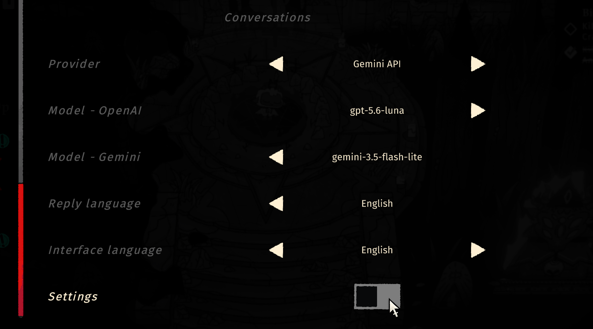
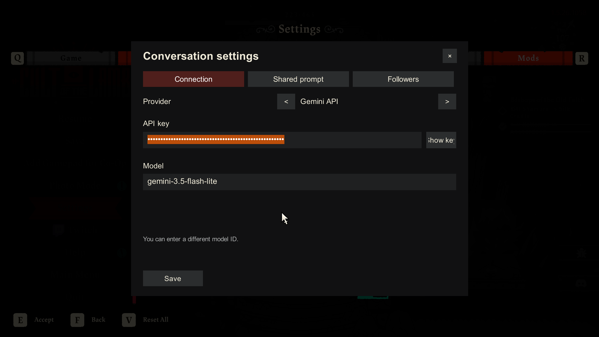

# How to set up AI / Chat is not working

1. In the game, open **Settings > Mods > Conversations** and select **Settings** to open the conversation settings.

2. In **Connection**, use the arrows to choose your provider. Paste **that provider's API key** into **API key**, check the model ID, and press **Save**. The key is hidden by default; the button beside it can reveal it temporarily. OpenClaw, Hermes, and custom OpenAI-compatible endpoints also need a server URL. A local OpenAI-compatible server may work without a key.

3. Interact with a follower, choose **Talk**, and send a message. A subscription to a chat website is not an API key; hosted providers require separate API access.

## Troubleshooting

| What you see | Likely cause | What to try |
| --- | --- | --- |
| **Talk** or **Conversations** is missing | The mod or COTL_API did not load | Check that the dependencies are installed and look for errors in `BepInEx/LogOutput.log`. Restart the game after installing the mod. |
| **Add an API key in settings first** | No key is saved for the selected provider | Choose the correct provider under **Connection**, paste its key, and press **Save**. A local OpenAI-compatible endpoint without authentication is the exception. |
| **HTTP 400** | The selected API rejected the request or model ID | Check the exact model ID and provider. For a custom endpoint, check its base URL. If you changed the shared prompt, try the default prompt. |
| **HTTP 401 / 403** | The key is invalid or lacks access to the model | Check the key, account permissions, and billing or quota. OpenCode Console free chat models are not available to external API clients. |
| **HTTP 404** | The model or API URL was not found | Check the model ID and server URL. For OpenClaw or Hermes, start the gateway and enable its HTTP API first. |
| **HTTP 429** | Rate limit or quota reached | Check your provider's limits and balance, wait, then retry. |
| **HTTP 500-503** or timeout | The provider or local server is temporarily unavailable | Check your connection and the provider's status. For local APIs, confirm that the server is running. Retry later or choose another model. |
| **The model returned no answer**, **invalid decision**, or **Could not read the model response** | The model returned an empty response or did not follow the required response format | Retry once. If it keeps happening, try a different model and restore the default shared prompt. |
| **Could not save the key securely** | The mod cannot write to `BepInEx/config` or Windows cannot protect the key | Check folder permissions and save while signed in to the same Windows account. Do not share your key file. |

If the issue remains, include the **error text** and relevant lines from `BepInEx/LogOutput.log` in a [GitHub issue](https://github.com/YarilaFox/CultOfTheLambTalk/issues). Remove API keys and personal information from screenshots and logs before posting.
