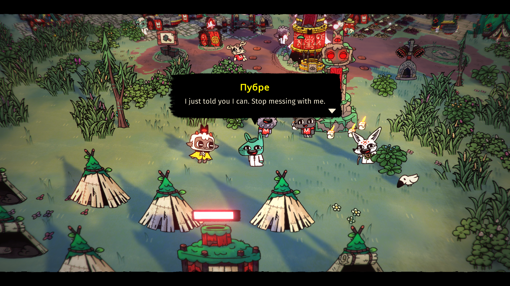

# Follower Talk

Talk to followers through Cult of the Lamb's dialogue UI. Each follower can remember recent exchanges, respond according to their current state, and attempt supported in-game actions when asked.

## Setup

1. Install the package with a compatible mod manager. BepInEx and COTL_API are declared as dependencies.
2. Open the game's **Settings > Mods > Conversations** menu. Choose a provider, model, and the reply and interface languages. Supported providers include OpenAI, Gemini, Claude, Grok, OpenCode Console, DeepSeek, OpenClaw Gateway, Hermes Agent, and custom OpenAI-compatible APIs.
3. Open **Settings** in that menu (or press F8), paste your API key, and save. The key is masked by default and stored locally for the current Windows user.
4. Choose **Talk** when interacting with a follower. Enter sends a message; Esc ends the conversation.

The conversation settings also include a shared prompt editor and per-follower instructions. Press F8 while talking to a follower to edit that follower's instructions. The altar menu has an option to address the whole cult.

API subscriptions and ChatGPT/Gemini chat subscriptions are separate. Model calls may incur API charges. The mod does not include an API key. Hosted providers require a key; a custom local endpoint may work without one.

OpenCode uses its Console inference API; free chat models are not available to external clients. OpenClaw and Hermes need their local HTTP endpoints enabled. These gateways can run agent tools, so configure their permissions before using them with game dialogue.

## Notes

- Interface text supports the game's languages. Reply language can follow the player's message or be set manually.
- Supported actions use game tasks and availability checks; followers cannot perform arbitrary game actions.
- Memories, API keys, and settings stay in the local `BepInEx/config` folder. Do not share that folder when reporting bugs.
- For manual installation, troubleshooting, and source inspection, see [GitHub](https://github.com/YarilaFox/CultOfTheLambTalk).
